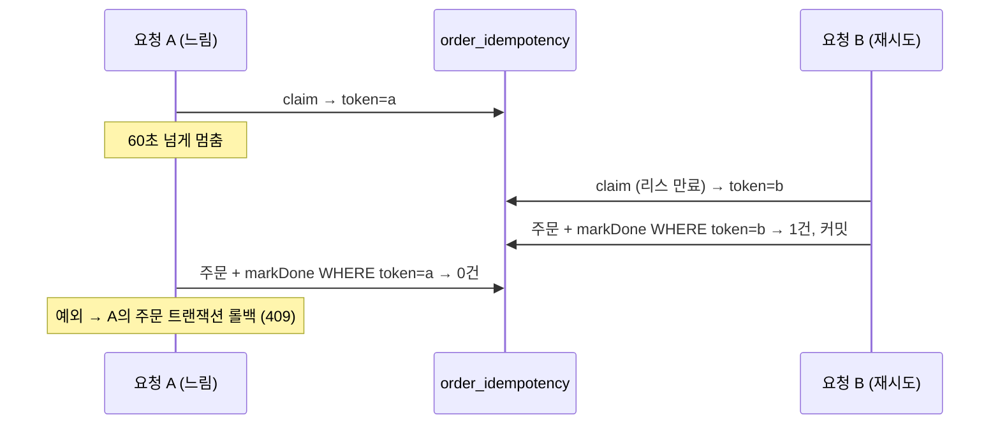

# ADR 0001. 주문 멱등성 재설계

- 상태: 채택 (2026-11-25)
- 범위: 시장가 매수 `POST /api/order/buy`, 시장가 매도 `POST /api/order/sell` (매도는 PR #6에서 확장)
- 관련 커밋: `8a153499` (phase1/idempotency)
- 이전 설계: V55 `order_idempotency` + Redis SETNX 선점 (2026-08)

## 1. 배경

시장가 매수는 요청과 동시에 체결되어 잔고가 빠지고 보유 수량이 늘어난다. 같은 주문이 두 번 처리되면 취소로 되돌릴 수 없다.
중복 주문은 사용자 실수(더블클릭)와 네트워크(응답 유실 후 클라이언트 재시도) 두 경로로 들어온다.
같은 종목을 같은 수량으로 두 번 사는 것도 정상 주문이라, 요청 내용이나 시간 간격으로는 중복을 구분할 수 없다.
그래서 클라이언트가 "주문 의도 1건"마다 키를 만들어 보내고, 서버는 그 키로 중복을 판단한다.

### 이전 설계

```
claimIdempotency(key)
  1) Redis SETNX idempotency:order:{key} (TTL 15분)  → 실패면 409
  2) INSERT order_idempotency(key, PROCESSING)        → UNIQUE 위반이면 409
validateQuantity → 시세 조회 → 잔고 차감 → 주문/체결 저장 → markDone(key, orderId)
```

AI 리뷰(CodeRabbit)와 테스트 수정 과정에서 나온 문제는 다음과 같다.

| # | 문제 | 실제로 일어나는 일 |
|---|---|---|
| P1 | 키 범위가 전역 | A가 쓴 키를 B가 보내면 B의 주문이 409로 막힌다. 재전송을 도입하면 A의 주문 결과가 B에게 보인다 |
| P2 | 주문이 롤백돼도 Redis 키가 남음 | 시세 API 장애로 주문이 실패해도 같은 키로 재시도하면 15분간 409 |
| P3 | Redis 장애 시 매수 전체 실패 | SETNX 예외가 그대로 올라가 DB 백스톱까지 가지 못함 |
| P4 | 헤더가 없으면 서버가 UUID를 새로 만듦 | 보호가 조용히 꺼진다. 클라이언트가 키를 빠뜨려도 아무도 모른다 |
| P5 | 중복을 409로만 응답 | 응답을 잃은 사용자는 주문이 됐는지 알 방법이 없다. 재시도하면 409만 받는다 |
| P6 | 선점이 입력 검증보다 먼저 | 수량 0 같은 잘못된 요청이 키를 선점해, 고친 요청이 같은 키로 막힌다 |
| P7 | 중복 INSERT가 예외로 끝남 | PostgreSQL 트랜잭션이 aborted 상태가 돼 같은 트랜잭션에서 기존 기록을 읽을 수 없다 |
| P8 | 멱등 기록을 지우지 않음 | 테이블이 계속 커진다 |

## 2. 결정

### 2.1 키는 클라이언트가 만들고, 서버는 믿지 않는다

- 계기: "프론트에서 발급한 키는 조작될 수 있다"는 지적.
- 대안: 서버가 1회용 주문 토큰을 먼저 발급하는 방식. 임의 키를 원천 차단하지만 주문마다 호출이 하나 늘고, 응답 유실 시 클라이언트가 토큰을 보관해야 하는 문제는 그대로 남는다.
- 선택: 클라이언트 발급을 유지하되 서버가 방어한다. 조작된 키로 할 수 있는 일을 하나씩 막는다.

| 조작 | 방어 |
|---|---|
| 남의 키를 가져와 보냄 | 키를 계좌별로 저장 (PK = 계좌 ID + 키). 다른 계좌의 기록은 보이지도 않는다 |
| 같은 키로 내용을 바꿔 보냄 | 요청 지문 비교. 종목·수량이 다르면 422 |
| 키를 빼거나 아무 문자열이나 보냄 | 헤더 누락은 400, UUID 형식(36자)이 아니면 400 |

요청 지문은 `SHA-256("BUY|MARKET|{stockId}|{quantity}|")`. 원문 대신 해시를 저장해 컬럼 길이가 고정된다.

### 2.2 같은 키로 다시 오면: 상태별 응답

| 기존 기록 | 응답 | 이유 |
|---|---|---|
| 없음 | 주문 실행 | |
| 지문이 다름 | 422 | 같은 키로 다른 의도를 보낸 클라이언트 버그. 조용히 처리하면 안 된다 |
| DONE | 첫 응답을 그대로 재전송 (`Idempotent-Replayed: true`) | 응답 유실 후 재시도한 사용자가 결과를 확인할 수 있어야 한다 (P5) |
| FAILED | 첫 거절을 그대로 재전송 | 잔고 부족 같은 거절도 확정된 결과다 |
| PROCESSING | 409 | 기다리게 하면 서버 스레드와 DB 커넥션을 붙잡는다. 클라이언트가 잠시 뒤 다시 묻는다 |

재전송하는 응답은 첫 응답 당시의 스냅샷이다 (`response_body` JSONB). 잔고를 지금 다시 읽으면 그 사이 다른 주문이 반영돼 첫 응답과 달라진다.
주문 자체는 `order_id`로 다시 읽는다.

### 2.3 실패는 두 종류로 나눈다

| 실패 | 예시 | 처리 | 이유 |
|---|---|---|---|
| 비즈니스 거절 (4xx) | 잔고 부족, 계좌 없음 | FAILED + 에러코드 기록 | 같은 요청을 다시 보내도 결과가 같다 |
| 일시적 오류 (5xx), 예상 못한 예외 | 시세 API 장애, DB 오류 | 선점 기록 삭제 | 주문이 일어나지 않았으므로 같은 키로 재시도해야 한다 (P2) |

잔고 부족으로 거절된 키는 입금한 뒤에도 같은 거절을 받는다. "같은 키 = 같은 의도"를 지키는 결과이고, 다시 사려면 새 키를 쓴다.
기록이나 삭제 자체가 실패하면(예: DB 장애) 원래 예외를 그대로 돌려주고 로그를 남긴다. 기록은 PROCESSING으로 남고 2.5의 리스로 회복된다.

### 2.4 트랜잭션 경계

```
MarketOrderFacade (트랜잭션 없음, PR #5에서 이름 변경)
  ├─ 입력 검증 (키 형식, 수량)                      ← P6: 부수효과 없는 검증을 먼저
  ├─ claim()          REQUIRES_NEW, 즉시 커밋       ← 동시 요청이 이 기록을 보고 멈춘다
  ├─ OrderService.buyMarket(.., key)  timeout 10s
  │     ├─ 잔고 차감, 주문·체결 저장, 보유 갱신
  │     └─ markDone()  REQUIRED (주문과 같은 트랜잭션)  ← 주문과 기록이 함께 커밋/롤백
  ├─ 4xx → markFailed()  REQUIRES_NEW
  └─ 5xx/예외 → release()  REQUIRES_NEW
```

- 선점을 주문 트랜잭션 안에 두면, 커밋 전까지 다른 요청에게 보이지 않아 동시 중복이 그대로 들어온다.
- DONE 기록을 주문 트랜잭션 밖에 두면, 주문 커밋과 기록 사이에 서버가 죽었을 때 "주문은 됐는데 기록은 PROCESSING"이 된다. 리스가 끝나면 재선점되어 이중 주문이 난다. 그래서 DONE만 주문 트랜잭션에 합류시켰다.

선점 SQL (P7):

```sql
INSERT INTO order_idempotency (...) VALUES (..., 'PROCESSING', now(), now())
ON CONFLICT (virtual_account_id, idempotency_key) DO UPDATE
    SET updated_at = now()
    WHERE order_idempotency.status = 'PROCESSING'
      AND order_idempotency.request_fingerprint = EXCLUDED.request_fingerprint
      AND order_idempotency.updated_at < now() - make_interval(secs => :leaseSeconds)
```

영향받은 행이 1이면 선점 성공, 0이면 기존 기록을 읽어 2.2대로 응답한다. 예외가 나지 않아 트랜잭션이 깨지지 않는다.
같은 키로 동시에 INSERT하면 PostgreSQL이 유니크 인덱스에서 뒤 요청을 앞 요청 커밋까지 기다리게 하므로 정확히 하나만 1을 받는다.

### 2.5 처리하던 서버가 죽으면: 리스

PROCESSING이 60초 넘게 갱신되지 않으면 같은 지문의 요청이 다시 선점할 수 있다 (위 SQL의 `DO UPDATE ... WHERE`).

- 리스(60초)는 주문 트랜잭션 타임아웃(10초)보다 충분히 길어야 한다. 반대면 아직 처리 중인 요청을 다른 요청이 가로채 이중 주문이 난다.
- 경과 시간은 DB의 `now()`로 잰다. 앱 서버 시계로 재면 인스턴스마다 시계가 어긋날 때 판정이 달라진다.
- 트랜잭션 타임아웃은 SQL 실행 시점에 검사되므로 "10초 안에 반드시 끝난다"는 엄밀한 보장은 아니다. 처음에는 "DB가 50초 이상 멈춰야 일어난다"며 한계로만 적었다.

### 2.5.1 펜싱 토큰 (2026-11-26 추가, CodeRabbit 재리뷰 반영)

리뷰 전용 PR #8에서 같은 구멍이 다른 경로로도 열려 있다는 지적을 받았다.

| 경로 | 일어나는 일 |
|---|---|
| 리스 만료 후 재선점 | 원래 요청이 늦게 `markDone`을 실행하면 `status = 'PROCESSING'` 조건이 재선점한 요청의 행에도 맞아 DONE이 된다. 두 주문이 모두 커밋된다 |
| 선점 직후 해제 | 같은 키의 앞 요청이 5xx로 행을 지운 순간 뒤 요청의 선점은 충돌(0건), 이어서 읽은 기록은 없음. 서비스가 이를 "선점 성공"으로 처리해 **기록 없이 주문**했다 |
| `markDone` 0건 | 갱신 건수를 보지 않아, 기록이 없거나 남의 것이어도 주문은 커밋됐다 |
| 정리 배치 | `created_at`만 보고 지워서, 24시간 넘은 키가 재선점돼 처리 중이면 그 행을 지울 수 있었다 |



- 선점할 때마다(재선점 포함) 새 UUID를 `claim_token`에 기록한다 (V58).
- `markDone`·`markFailed`·`release`는 `claim_token = :token`일 때만 행을 바꾼다. 남의 선점을 완료·거절·해제할 수 없다.
- `markDone`이 1건이 아니면 `ORDER_REQUEST_IN_PROGRESS`(409)로 주문 트랜잭션을 롤백한다. 같은 키의 다른 요청이 처리 중이므로 클라이언트는 잠시 뒤 같은 키로 결과를 받는다.
- 선점이 0건인데 기록도 없으면 최대 3번 다시 선점하고, 그래도 안 되면 409. 기록 없이 진행하지 않는다.
- 정리 배치는 리스 안에서 갱신된 PROCESSING을 지우지 않는다.

토큰은 선점 시각(`updated_at`)을 비교하는 방법도 있었지만, 시각은 같은 마이크로초에 겹칠 수 있고 다른 갱신에도 바뀐다. 목적이 하나인 컬럼을 따로 두는 쪽이 읽기 쉽다.

### 2.6 보존과 정리 (P8)

- 24시간 보관 (Stripe와 같은 기준). 하루 지난 재시도는 새 주문으로 보는 것이 자연스럽다.
- `OrderIdempotencyCleanupScheduler`가 10분마다 `created_at < now() - 24h`인 기록을 1,000건씩 각자 트랜잭션으로 지운다. 한 번에 지우면 대량 행 락과 WAL 폭증이 생긴다.
- 한 번 실행에서 최대 100회(10만 건)까지만 지우고 나머지는 다음 실행으로 넘긴다.
- 삭제는 몇 번을 다시 돌려도 결과가 같아서, 여러 인스턴스가 동시에 돌거나 중간에 죽어도 분산 락이 필요 없다.

### 2.7 Redis를 주문 경로에서 뺐다

처음 계획은 Redis 선점(SETNX, Lua)과 DB 단독을 장애 주입(Toxiproxy)으로 비교하는 것이었다. 설계를 바꾸고 나니 비교 전에 결론이 났다.

- 재전송을 하려면 기존 기록의 상태와 응답이 필요하다. SETNX는 "키가 있다"만 알려주므로 결국 DB를 다시 읽는다. Redis가 DB 접근을 줄이지 못한다.
- Redis가 상태와 응답까지 들고 있으면(Lua) DB 접근은 줄지만 기록이 두 곳에 생긴다. 주문 커밋 후 Redis 갱신이 실패하면 둘이 어긋나고, 이를 맞추는 코드가 새 장애 지점이 된다.
- Redis를 남기면 장애 대응(fail-open, 타임아웃, 서킷 브레이커)도 함께 설계해야 한다. Lettuce는 연결이 끊기면 명령을 큐에 쌓아 두고 타임아웃까지 기다리므로, 짧은 타임아웃 없이 fail-open만 두면 Redis 장애 동안 모든 주문이 타임아웃만큼 느려진다.
- DB 단독 선점은 PK 인덱스 INSERT 1회라 비용이 작다. 이 서비스의 중복은 더블클릭과 재시도 수준이라 "중복 요청이 몰려 DB가 버거운" 상황이 아니다.

그래서 DB 단독으로 결정했다. 결과적으로 P3(Redis 장애 시 매수 전체 실패)는 의존성 자체가 사라져 해결됐다.
Redis 앞단 캐시는 같은 키의 중복이 초당 수백 건 이상 몰리는 패턴이 실제로 관측될 때 다시 검토한다. 그때는 Lua로 상태를 원자적으로 다루고, 짧은 명령 타임아웃과 서킷 브레이커를 함께 둔다.

장애 주입 비교 실험은 마감 일정(2026-11-30) 때문에 하지 않았다. 위 판단은 측정이 아니라 설계 분석에 근거한다.

## 3. 마이그레이션 (V56, V58)

- 기존 V55 행은 계좌 정보가 없어 채울 수 없다. 보존 기간 24시간짜리 임시 기록이므로 비우고 시작한다. `orders`는 건드리지 않으므로 잃는 것은 "배포 직전 24시간 내 키의 재전송"뿐이다.
- PK를 `(virtual_account_id, idempotency_key)`로 바꾸고 `request_fingerprint`, `error_code`, `response_body JSONB`, `updated_at`을 추가한다.
- 정리 배치용 `created_at` 인덱스를 추가한다.
- 운영 배포 시 주의 (CodeRabbit 재리뷰 지적): 기존 행을 지우는 순간 배포 직전 24시간의 키는 중복 방지가 사라진다. 이 포크의 V55·V56은 운영에 배포된 적이 없어 그대로 두었다. 운영에 처음 적용한다면 V56을 두 단계로 나눠야 한다. 새 컬럼과 새 PK를 추가해 새 요청부터 계좌별로 기록하고, 옛 행은 보존 기간(24시간)이 끝난 뒤 정리 배치가 지우게 한다.
- V58: 펜싱 토큰 `claim_token UUID` (2.5.1). 기존 행은 NULL이며, NULL은 어떤 토큰과도 일치하지 않아 리스 만료 후 재선점될 때 새 토큰을 받는다.

## 4. 클라이언트 계약

```
POST /api/order/buy
Idempotency-Key: <UUID, 주문 버튼을 누를 때 1회 생성>
```

| 응답 | 의미 | 클라이언트 동작 |
|---|---|---|
| 200 | 새 주문 체결 | 키 폐기 |
| 200 + `Idempotent-Replayed: true` | 이미 처리된 주문의 결과 | 키 폐기. "이미 접수된 주문" 안내 |
| 400 `ORDER_IDEMPOTENCY_KEY_*` | 키 누락·형식 오류 | 클라이언트 버그 |
| 409 `ORDER_REQUEST_IN_PROGRESS` | 같은 주문 처리 중 | 같은 키로 잠시 뒤 재요청 |
| 422 `ORDER_IDEMPOTENCY_KEY_REUSED` | 같은 키로 다른 내용 | 클라이언트 버그 |
| 4xx 비즈니스 에러 | 확정 거절 | 사용자가 다시 시도하면 새 키 생성 |
| 5xx / 네트워크 오류 | 처리 안 됨 또는 알 수 없음 | **같은 키로** 재요청 |

프론트(wefin-fe)는 아직 키를 보내지 않는다. 팀 레포라 이 포크에서는 수정하지 않았고, 이 브랜치의 백엔드는 헤더 없는 매수를 400으로 거절한다.
프론트 변경은 주문 버튼 클릭 시 `crypto.randomUUID()`로 키를 만들어 위 표대로 재시도하는 것뿐이다.
axios 타임아웃(5초)도 "5xx / 네트워크 오류"와 같이 다룬다. 커넥션 풀이 가득 차면 서버는 최대 약 9초 뒤에 주문을 커밋할 수 있어, 타임아웃이 난 주문도 실제로는 체결됐을 수 있다. 같은 키로 다시 보내면 커밋된 첫 응답을 받는다 (계산은 [references.md](../references.md) 3절).

## 5. 검증

`OrderIdempotencyTest` (Testcontainers PostgreSQL 16, 11개)

| 시나리오 | 기대 |
|---|---|
| 같은 키 재요청 (사이에 다른 주문으로 잔고 변경) | 같은 주문번호, 첫 응답 당시 잔고, 주문 수 그대로 |
| 같은 키, 다른 수량 | 422, 주문 1건 |
| 다른 계좌가 같은 키 사용 | 둘 다 새 주문 |
| 잔고 부족 → 입금 → 같은 키 | 같은 거절. 새 키는 성공. 기록 상태 FAILED |
| 시세 장애(503) → 복구 → 같은 키 | 첫 요청 후 기록 없음, 재시도 성공 |
| 예상 못한 런타임 예외 → 같은 키 | 기록·주문 없음, 재시도 성공 |
| PROCESSING(방금) | 409, 주문 0건 |
| PROCESSING(2분 전, 리스 초과) | 재선점해 주문, 상태 DONE |
| 수량 0 → 수량 1, 같은 키 | 첫 요청은 기록을 남기지 않고, 고친 요청이 통과 |
| 키 누락·공백·`abc`·`1-1-1-1-1` | 400 |
| 25시간 전·23시간 전 기록 | 정리 배치가 25시간 전 것만 삭제 |

추가 (2026-11-26, 2.5.1)

| 시나리오 | 기대 |
|---|---|
| 리스 만료 후 다른 요청이 재선점해 주문, 원래 요청이 뒤늦게 완료 시도 | 원래 요청 409, 주문 1건, 잔고는 재시도 후 그대로 |
| 25시간 전 생성됐지만 방금 재선점된 PROCESSING | 정리 배치가 지우지 않음 |
| 선점 충돌 직후 기록이 지워짐 (단위 테스트) | 다시 선점. 3번 모두 실패하면 409 |
| 매도에서 같은 상황 (PR #11 재리뷰) | 원래 요청 409, 보유 수량은 한 번만 차감, 잔고 그대로 |

`OrderConcurrencyTest`: 같은 키 동시 5건 → 주문 1건, 나머지 4건은 409 또는 재전송, 잔고는 한 번만 차감, 체결 1건, 보유 1주. 다른 키 동시 5건 → 주문 5건.
같은 키 동시 10건이 모두 시세 장애(503)를 만나 선점 해제가 반복돼도 → 주문 0건, 잔고 그대로, 멱등 기록 0건.

작성 당시 전체 테스트 894개 통과 (`./gradlew test`, 벤치마크 제외). 현재 개수는 README.

## 6. 남은 것

- 지정가 주문에 같은 멱등 처리 적용 (시장가 매수·매도는 적용됨)
- 프론트 키 발급 (4절)
- 409 응답에 `Retry-After` 헤더 추가
