# 주문·체결·자산 모듈 변경 기록

팀 프로젝트(S0L-V/wefin-be)에서 제가 맡은 주문·체결·자산 모듈을 개인 포크에서 어떻게 바꿨는지, 각 단계에서 무엇을 보고 어떤 판단을 했는지 정리한 문서입니다.
결정 하나하나의 근거는 ADR에 있고, 이 문서는 전체 흐름과 면접에서 설명할 순서를 기준으로 묶었습니다.

| 시점 | 기준 | 내용 |
|---|---|---|
| 팀 프로젝트 (2026.03~04) | 커밋 `fa8f2ac4` | 비관적 락, 멱등 없음, 원장 없음, 트랜잭션 안에서 시세 조회 |
| v1 (2026.11.08) | PR #1 | 원자적 UPDATE, Redis SETNX + DB UNIQUE 멱등, 트레이딩 인덱스 |
| v2 (2026.11.25~) | PR #2~#7 | 측정 기반 정리, 멱등 재설계, 현금 원장과 대사, 외부 API 장애 격리 |

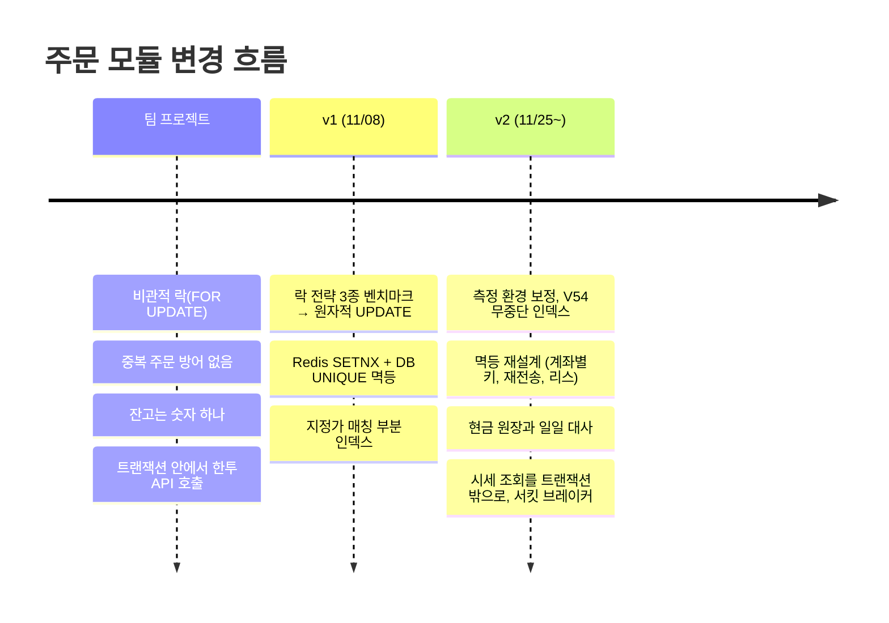

---

## 1. 잔고 차감: 비관적 락 → 원자적 UPDATE

### 원래 코드

```java
// VirtualAccountService.deductBalance (팀 프로젝트)
VirtualAccount account = getAccountForUpdate(id);   // SELECT ... FOR UPDATE
account.deduct(amount);                             // 엔티티에서 잔고 검사 후 차감 → 더티 체킹으로 UPDATE
```

같은 계좌에 동시 요청이 오면 모두 한 행의 락을 기다립니다. 정합성은 맞지만, 락을 잡은 채로 엔티티를 읽고 검사하고 쓰는 동안 다른 요청이 전부 줄을 섭니다.

팀 프로젝트 중(2026.04)에 동시성 통합 테스트로 데드락도 한 번 재현했습니다. 매수는 계좌 → 보유 순서로, 매도는 보유 → 계좌 순서로 락을 잡고 있었습니다.

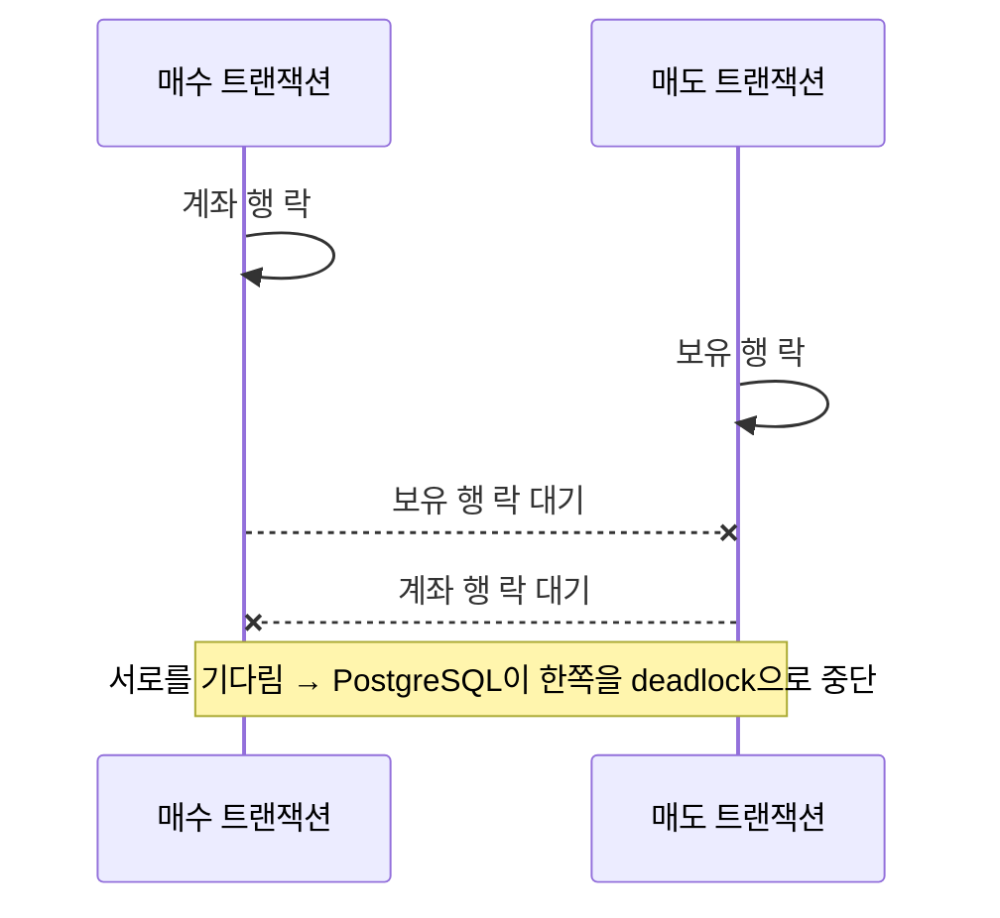

두 자원을 잠그는 모든 경로의 락 순서를 계좌 → 보유로 통일해 해결했습니다 (팀 PR #129). 이 일을 계기로 "비관적 락이 최선인가"를 측정해 보기로 했습니다.

### 판단

세 가지를 같은 조건에서 측정해 고르기로 했습니다 (`LockStrategyBenchmarkTest`, 단일 계좌에 동시 매수).

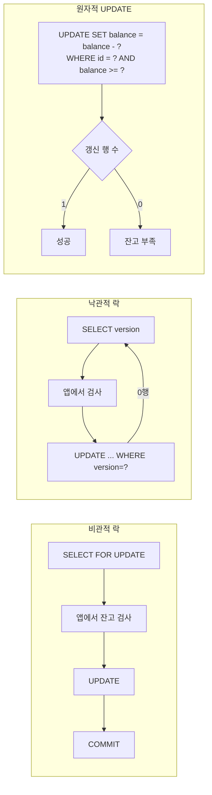

| 전략 | 1스레드 | 20스레드 | 50스레드 |
|---|---:|---:|---|
| 비관적 | 454 ops/s | 483 ops/s | p95 268ms |
| 낙관적 | 472 ops/s | 82 ops/s | 재시도 89,210회, p95 3.8s |
| 원자적 | **781 ops/s** | **918 ops/s** | p95 166ms |

- 낙관적 락은 같은 계좌에 경합이 몰리면 재시도가 폭증합니다. 잔고처럼 한 행에 쓰기가 집중되는 곳에는 맞지 않습니다.
- 원자적 UPDATE는 검사와 차감을 SQL 한 문장으로 합쳐서 "읽고 나서 쓰는 틈" 자체가 없습니다. 락은 UPDATE 동안만 잡힙니다.
- 37건 분량 잔고에 100건을 동시에 보내도 세 전략 모두 정확히 37건만 성공했습니다. 정합성은 같고 처리량만 다릅니다.
- 그래서 **단일 잔고 차감**(시장가 매수, 지정가 매수 예약)만 원자적 UPDATE로 바꿨습니다. 보유 수량·평균단가처럼 여러 값을 읽고 다시 계산해야 하는 경로(매도, 정정, 취소, 체결)는 비관적 락을 유지합니다. 한 문장 UPDATE로 표현하기 어렵고, 억지로 넣으면 SQL에 비즈니스 계산이 들어갑니다.

### 면접 대비

- **왜 원자적 UPDATE가 빠른가?** 비관적 락은 SELECT, 앱 검사, UPDATE, 커밋까지 락을 쥡니다. 원자적 UPDATE는 행 락을 UPDATE 한 문장 동안만 쥐고 왕복도 한 번 적습니다.
- **언제 원자적 UPDATE를 못 쓰나?** 차감 여부를 판단하려면 여러 테이블을 읽어야 하거나, 차감 전 값으로 복잡한 계산을 해야 할 때입니다. 그때는 비관적 락이 맞습니다.
- **한계:** 벤치마크는 단일 계좌 최악 경합 기준입니다. 실제로는 계좌가 분산돼 차이가 이보다 작습니다.
- **잔고 경계값:** `BalanceBoundaryTest`가 실제 시장가 매수 경로로 확인합니다. 잔고와 정확히 같은 금액이면 체결 후 0원, 1원 부족하면 거절하고 잔고·주문·원장을 건드리지 않습니다. 3건 분량 + (1건 - 1원) 잔고에 10건을 동시에 보내면 3건만 체결되고 나머지 잔고가 남습니다.

---

## 2. 인덱스와 무중단 마이그레이션 (PR #2)

### 원래 상태

지정가 매칭은 시세 틱마다 종목·주문 유형·미체결 상태(PENDING, PARTIAL)로 주문을 `FOR UPDATE`로 조회하는데, 맞는 인덱스가 없었습니다. 체결내역 커서 페이징과 일일 랭킹 집계도 같은 상황이었습니다.

### 판단

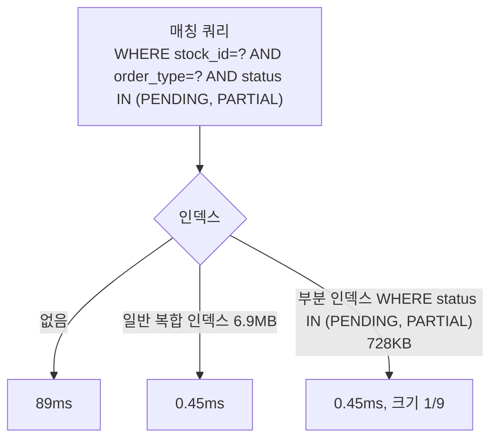

- 체결되거나 취소된 주문은 매칭에서 다시 볼 일이 없습니다. 미체결만 인덱스에 넣으면 속도는 같고 크기는 1/9입니다. 100만 건 기준으로 체결내역 첫 페이지는 82.8ms → 0.006ms, 일일 랭킹 집계는 86.1ms → 4.3ms입니다.
- 운영 테이블에 일반 `CREATE INDEX`를 걸면 생성 동안 쓰기가 막혀 주문이 멈춥니다. `CONCURRENTLY`로 바꿨습니다.

### 바꾸다가 막힌 것

`CONCURRENTLY`로 바꾸자 Flyway 마이그레이션이 끝나지 않았습니다.

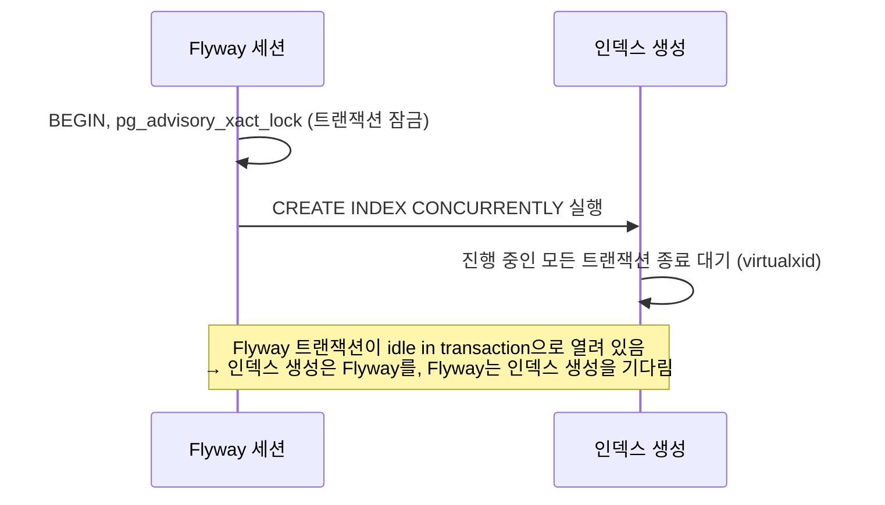

`pg_stat_activity`와 `pg_locks`로 위 상태를 확인했고, `spring.flyway.postgresql.transactional-lock=false`로 Flyway 잠금을 세션 단위로 바꿔 해결했습니다. 여러 인스턴스가 동시에 마이그레이션하지 못하게 막는 기능은 그대로 유지됩니다.
중간에 실패하면 INVALID 인덱스가 남기 때문에 `IF NOT EXISTS`와 복구 절차를 마이그레이션 주석에 남겼습니다 (CodeRabbit 지적 반영).

### 면접 대비

- **CONCURRENTLY는 왜 트랜잭션 안에서 못 도나?** 테이블을 두 번 스캔하면서 그 사이에 시작된 트랜잭션이 끝나기를 기다려야 해서, 자기 자신이 트랜잭션 안에 있으면 성립하지 않습니다.
- **부분 인덱스의 조건이 쿼리와 어긋나면?** 플래너가 인덱스를 쓰지 않습니다. 쿼리의 WHERE와 인덱스 조건을 똑같이 맞췄고, `EXPLAIN`으로 확인했습니다.

---

## 3. 주문 멱등성 (PR #3, #6, [ADR 0001](adr/0001-order-idempotency.md))

### 원래 → v1 → v2

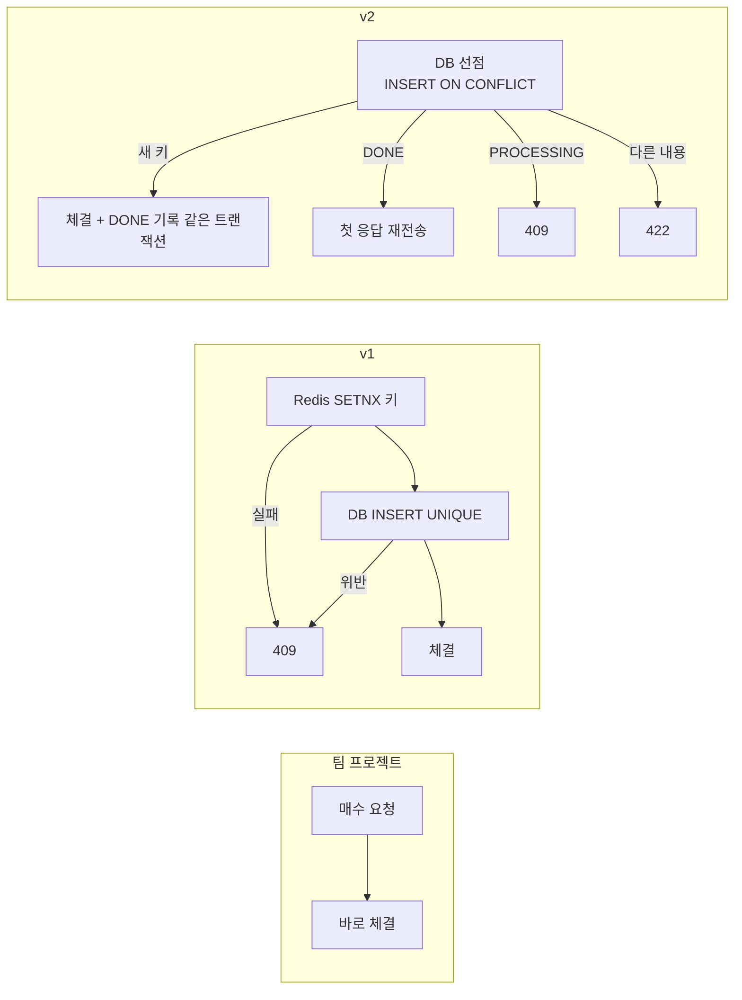

팀 프로젝트에는 중복 주문 방어가 없었습니다. 더블클릭이나 응답 유실 후 재시도로 시장가 매수가 두 번 체결될 수 있었습니다.
v1에서 Redis SETNX와 DB UNIQUE를 넣었는데, CodeRabbit 리뷰와 테스트 수정 중에 아래 문제가 나왔습니다.

| 문제 | 실제로 일어나는 일 |
|---|---|
| 키가 전역 | 다른 사용자가 같은 키를 보내면 내 주문이 막힘. 재전송을 넣으면 남의 주문 결과가 보임 |
| 주문이 롤백돼도 Redis 키가 남음 | 시세 장애로 실패한 주문을 같은 키로 재시도하면 15분간 409 |
| Redis 장애 = 매수 전체 장애 | SETNX 예외가 그대로 올라감 |
| 중복이면 409뿐 | 응답을 잃은 사용자는 주문이 됐는지 알 수 없음 |
| 중복 INSERT가 예외 | PostgreSQL 트랜잭션이 aborted 상태가 돼 기존 기록을 읽을 수 없음 |

### v2 요청 흐름

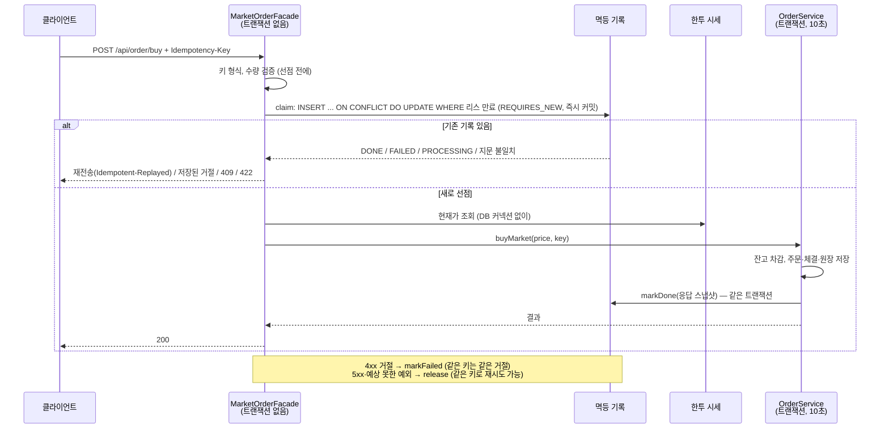

### 리스가 넘어간 뒤 늦게 끝난 요청 (펜싱 토큰)

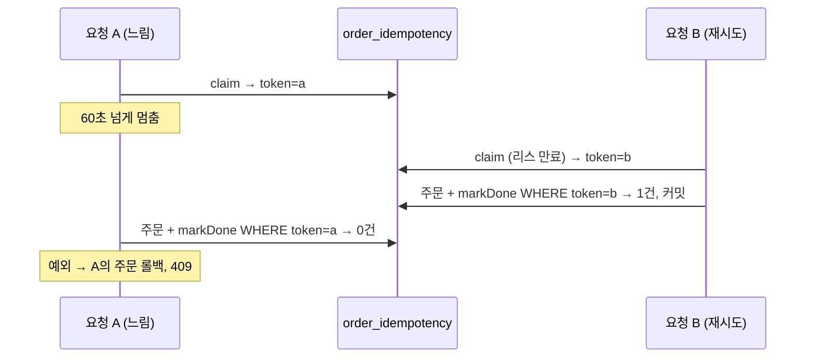

### 판단 포인트

| 결정 | 이유 | 버린 대안 |
|---|---|---|
| 키를 계좌별로 저장 (PK = 계좌 + 키) | 남의 키로 남의 결과를 볼 수 없음 | 전역 키 |
| 요청 지문(SHA-256) 비교, 다르면 422 | 같은 키로 다른 주문을 보내는 클라이언트 버그를 조용히 넘기지 않음 | 키만 비교 |
| DONE이면 첫 응답 스냅샷 재전송 | 응답을 잃은 사용자가 결과를 확인할 수 있어야 함. 잔고를 지금 다시 읽으면 첫 응답과 달라짐 | 409만 응답 |
| 4xx는 FAILED, 5xx는 선점 해제 | 잔고 부족은 다시 보내도 같은 결과, 시세 장애는 주문이 안 일어났으니 재시도가 맞음 | 실패 구분 없음 |
| 선점은 REQUIRES_NEW, DONE은 주문 트랜잭션 합류 | 선점이 바로 보여야 동시 중복을 막음. DONE이 따로면 커밋 직후 서버가 죽을 때 이중 주문 | 모두 한 트랜잭션 / 모두 분리 |
| 처리 중 서버가 죽으면 60초 리스 후 재선점 (DB `now()` 기준) | PROCESSING이 영원히 남지 않게. 앱 서버 시계는 인스턴스마다 다를 수 있음 | TTL 없음 |
| 선점마다 펜싱 토큰, 완료·거절·해제는 토큰 일치 시에만 | 리스가 넘어간 뒤 늦게 끝난 요청이 남의 선점을 완료 처리하면 이중 주문. 완료 0건이면 롤백 | 선점 시각 비교 (같은 시각 충돌, 다른 갱신에도 바뀜) |
| Redis 제거, DB 단독 | 재전송하려면 결국 DB 기록을 읽어야 함. Redis에 상태까지 두면 두 저장소 정합성 문제가 새로 생김 | Redis SETNX, Redis Lua |

### 면접 대비

- **Redis를 왜 뺐나? 성능은?** 재전송을 하려면 상태와 응답이 필요한데 SETNX는 키 존재만 알려줘서 DB를 어차피 읽습니다. DB 선점은 PK 인덱스 INSERT 한 번입니다. 이 서비스의 중복은 더블클릭과 재시도 수준입니다. 같은 키 중복이 초당 수백 건 몰리는 게 관측되면 Lua + 짧은 타임아웃 + 서킷 브레이커로 앞단에 다시 둡니다. 비교 측정은 하지 않았고 설계 분석에 근거한 결정입니다.
- **같은 키 동시 요청 두 개가 둘 다 선점하지 않나?** PostgreSQL이 유니크 인덱스에서 뒤 INSERT를 앞 트랜잭션 커밋까지 기다리게 합니다. 선점이 REQUIRES_NEW로 바로 커밋되니 대기도 짧습니다. 동시 5건 테스트에서 주문은 1건입니다.
- **리스 60초가 끝났는데 원래 요청이 아직 처리 중이면?** 처음에는 "트랜잭션 타임아웃 10초라 실제로는 어렵다"며 한계로 남겼습니다. 재리뷰(PR #8)에서 같은 구멍이 "선점 직후 다른 요청의 해제", "markDone 0건 무시" 경로로도 열려 있다는 지적을 받고 펜싱 토큰을 넣었습니다. 선점마다 새 토큰을 기록하고, 완료·거절·해제는 자기 토큰일 때만 반영합니다. 완료가 0건이면 주문 트랜잭션을 롤백하고 409를 돌려줍니다 (ADR 0001 2.5.1).
- **저장된 에러코드 이름이 바뀌면?** 재전송이 500이 되지 않도록 `ORDER_PREVIOUSLY_REJECTED`로 응답합니다 (PR #6).
- **프론트는?** 팀 레포라 수정하지 않았습니다. 헤더 계약과 재시도 규칙은 ADR 4절에 있고, HTTP 레벨 테스트(`OrderIdempotencyApiTest`)로 계약을 검증합니다.

---

## 4. 현금 원장과 일일 대사 (PR #4, [ADR 0002](adr/0002-cash-ledger-reconciliation.md))

### 원래 상태

잔고는 `virtual_account.balance` 숫자 하나였고, 잔고를 바꾸는 경로가 10개, 서비스 네 곳에 흩어져 있었습니다. 체결 내역(trade)은 있지만 지정가 예약금, 정정 차액, 취소 환불, 퀘스트 보상은 체결이 아니라 기록이 없었습니다.
잔고가 틀려도 비교할 대상이 없어서 알 수 없고, 왜 그 값이 됐는지 추적할 수 없었습니다.

### 바꾼 구조

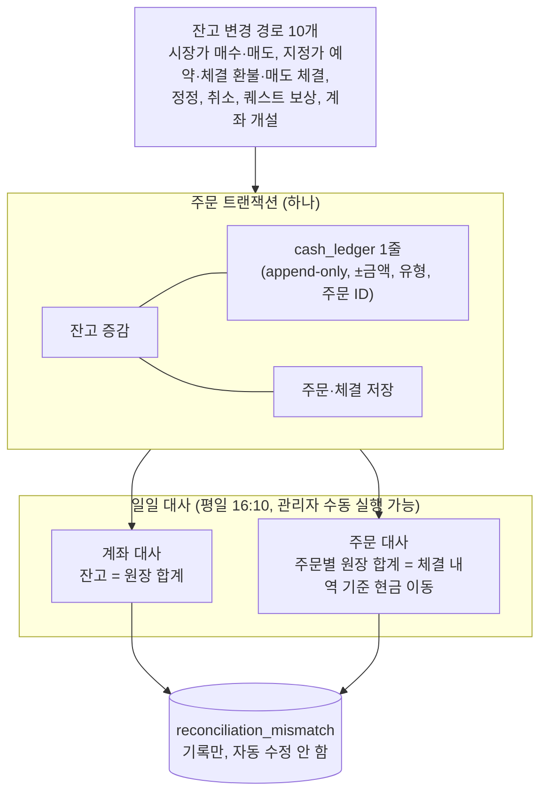

`CashLedgerService.record()`는 `Propagation.MANDATORY`라서 트랜잭션 없이 부르면 예외가 납니다. 원장만 남고 잔고는 롤백되는 경우를 호출 실수로도 만들 수 없습니다.

### 대사 실행 관리

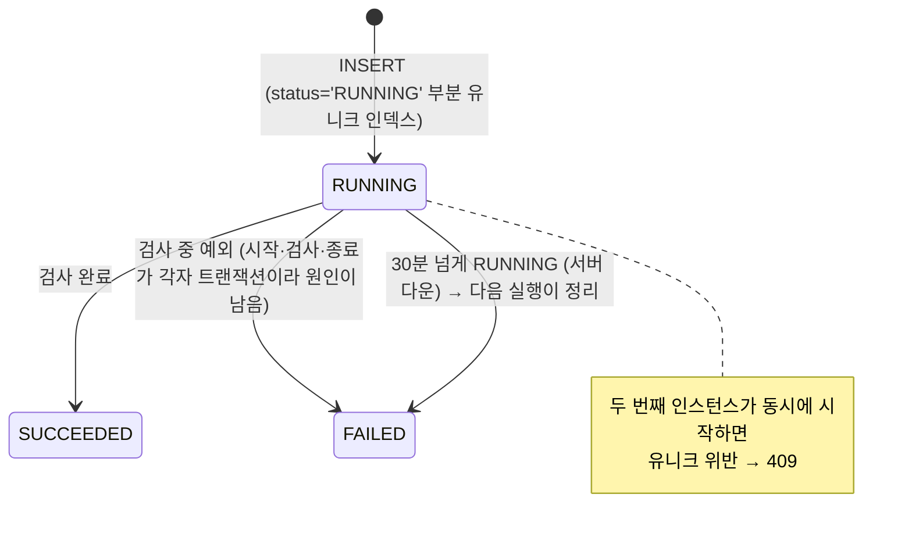

### 판단 포인트

| 결정 | 이유 | 버린 대안 |
|---|---|---|
| 단식 원장 | 현금은 사용자 계좌와 외부 시장 사이만 오감. 복식으로 바꿔도 새로 잡히는 오류가 없음 | 복식부기 (송금·수수료 수익 계정이 생기면 전환) |
| 대사를 두 가지로 | 계좌 대사는 "잔고와 원장이 같이 틀린" 경우(환불 계산 오류)를 못 잡음. 주문 대사가 체결 내역이라는 독립 기록과 맞춤 | 계좌 대사만 |
| 장중에도 대사 가능 | 각 검사가 SQL 한 문장이라 한 스냅샷을 읽고, 잔고와 원장은 같이 커밋됨 | 장 마감 후에만 |
| 불일치는 기록만 | 원장이 빠진 건지 잔고가 틀린 건지 원인을 봐야 앎. 확인 없이 돈을 움직이면 오류가 하나 더 생김 | 자동 보정 |
| 동시 실행 방지를 DB 제약으로 | 부분 유니크 인덱스 하나로 끝. 추가 장애 지점 없음 | ShedLock, Redis 분산 락 |
| 실행 시작 시각도 DB 시계 | 중단 판정이 DB `now()`인데 시작 시각을 앱 시계로 넣었다가 중간점검에서 발견해 수정 | 앱 시계 |

### 면접 대비

- **원장 도입 전 데이터는?** 마이그레이션 시점 잔고를 `OPENING_BALANCE` 한 줄로 넣었습니다. 그 전 이동은 복원할 수 없어서 대사는 도입 이후만 보장하고, 주문 대사는 도입 이후 생성된 주문만 봅니다.
- **원장이 커지면?** 지금은 매번 전체 합산입니다. 일별 마감 잔액(체크포인트)을 남기고 이후분만 더하는 방식으로 바꿔야 합니다.
- **어떻게 검증했나?** 원장을 거치지 않고 잔고를 바꾸면 계좌 불일치가 잡히고, 환불 원장 한 줄을 지우면 계좌·주문 불일치가 함께 잡히는지 테스트합니다. 4개 계좌가 계속 매수하는 동안 대사를 10번 돌려도 불일치 0건입니다.

---

## 5. 외부 시세 API 장애 격리 (PR #5, [ADR 0003](adr/0003-market-api-isolation.md))

### 발견 경위

멱등 설계에서 주문 트랜잭션 타임아웃(10초)을 다시 보다가, 시장가 매수가 `@Transactional` 안에서 한투 시세를 조회한다는 걸 확인했습니다.
Spring 트랜잭션 타임아웃은 SQL 실행 시점에만 검사되므로 HTTP 대기 중에는 동작하지 않습니다.

### 원래 → 지금

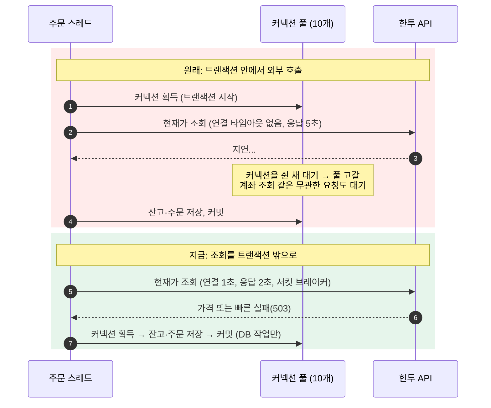

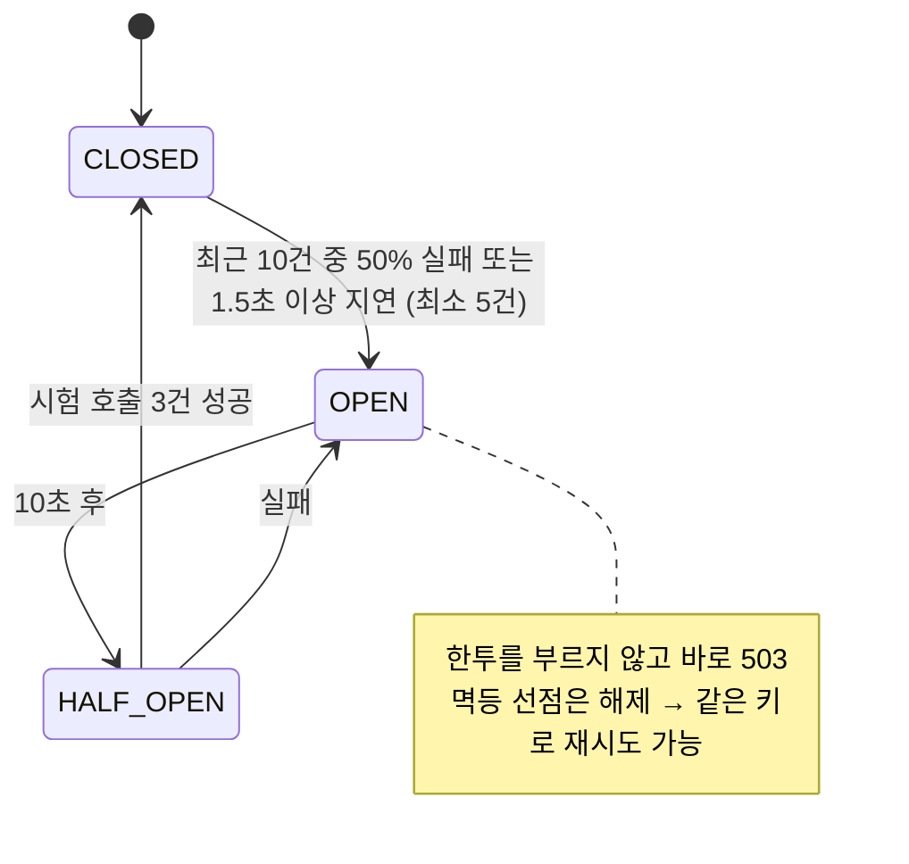

### 측정 (MarketOutageBenchmarkTest)

로컬 HTTP 서버로 한투를 흉내 내 응답을 일부러 늦추고, 캐시에 없는 20개 종목을 동시에 매수하는 동안 무관한 계좌 조회의 응답 시간을 쟀습니다. 수정 전 코드는 `git worktree`로 꺼내 같은 조건으로 돌렸습니다.

| 시나리오 | 무관한 조회 최대 (전 → 후) | 2차 매수 p50 (전 → 후) | 한투 호출 (전 → 후) |
|---|---|---|---|
| 응답 1초 지연 | 1,242ms → 45ms | | |
| 응답 3초 지연 | 2,977ms → 17ms | 6,245ms → 30ms | 40 → 20 |
| 무응답 | 4,896ms → 30ms | 10,070ms → 24ms | 40 → 20 |

### 판단 포인트

| 결정 | 이유 | 버린 대안 |
|---|---|---|
| 조회를 트랜잭션 밖으로 | 외부 지연이 DB 커넥션 풀로 번지지 않게. 가격이 조회와 체결 사이에 바뀔 수 있는 건 원래도 같음 | 풀 크기 확대 (대기만 늦출 뿐) |
| 응답 2초 타임아웃 | 정상 응답은 수십 ms. 2초 넘게 걸린 시세로 체결하느니 거절 | 기존 5초 |
| 서킷 브레이커 | 장애 동안 모든 요청이 2초씩 기다리고 한투에 재시도가 몰리는 것을 막음 | 타임아웃만 |
| 오래된 가격으로 대체하지 않음 | 시세 화면은 몇 초 전 값이어도 되지만, 시장가 주문을 오래된 가격으로 체결하면 실제와 다른 가격에 사게 됨 | stale 캐시 폴백 |

### 면접 대비

- **트레이드오프는?** 예전에는 한투가 3초 걸려도 6초 뒤에 주문이 성공했습니다. 지금은 2초에 거절합니다. 사용자 한 명은 실패를 받지만 서비스 전체는 멈추지 않습니다.
- **서버가 여러 대면?** 브레이커 상태가 인스턴스마다 따로라 각자 5건씩 실패해야 열립니다. 알고 있는 한계입니다.
- **남은 병목은?** `HantuTokenManager`가 `synchronized`라 토큰 갱신이 막히면 모든 시세 호출이 줄 섭니다. 다음에 분리할 부분입니다.

---

## 6. 코드 리뷰를 어떻게 썼나

- 모든 변경은 PR로 올렸습니다. CodeRabbit 리뷰 기준(`.coderabbit.yaml`)은 증권 거래 도메인 관점(금액 정확성, 정합성, 동시성, 멱등, 트랜잭션 경계)으로 직접 적었습니다.
- v1 멱등 설계의 문제(전역 키, Redis 키 잔존 등) 상당수가 리뷰에서 나왔고, v2 재설계의 출발점이 됐습니다.
- 지적은 그대로 받지 않고 현재 코드 기준으로 다시 확인했습니다. 예를 들어 "이미 적용된 V54를 수정했다"는 지적은 V54가 팀 레포와 운영에 배포된 적 없는 포크 전용 파일이라 수정하지 않고 PR에 이유를 남겼습니다.
- 머지 후 리뷰 한도에 걸려 리뷰를 못 받은 PR(#3~#6)은 리뷰 전용 PR(#8~#11)로 다시 열어 받았습니다. 반영 결과는 아래에 추가합니다.

### 리뷰 반영 기록

| 출처 | 지적 | 판단 | 반영 |
|---|---|---|---|
| PR #2 | 잔고 경계값(0원, 1원 부족, 정확히 같은 금액, 나누어떨어지지 않는 잔고) 테스트 없음 | 타당. 잔고 차감 SQL이 모킹 테스트로만 검증돼 있었음 | `BalanceBoundaryTest` 4개 |
| PR #2 | 컨트롤러 테스트가 멱등키 전달을 검증하지 않음 | 이미 해결. `OrderIdempotencyApiTest`가 같은 키 재요청으로 재전송을 확인 | 없음 |
| PR #2 | 벤치마크 측정 순서 고정, 원시 표본 미보존 | 타당하지만 결론(수십~수백 배 차이)을 뒤집을 크기는 아님 | 보류 |
| PR #8 (멱등) | 선점 충돌 직후 기록이 지워지면 "기록 없음"을 선점 성공으로 오인해 기록 없이 주문 | **타당, 실제 구멍.** 같은 키 요청이 5xx로 해제하는 순간 재현 가능 | 최대 3회 재선점, 실패 시 409 |
| PR #8 | `markDone` 갱신 건수 무시, 리스 넘어간 선점도 완료 처리 가능 | 타당. ADR에 한계로만 적어 둔 문제가 다른 경로로도 열려 있었음 | 펜싱 토큰(V58), 0건이면 롤백 |
| PR #8 | 정리 배치가 재선점돼 처리 중인 행을 지울 수 있음 | 타당 (24시간 넘은 키 재사용 시) | 리스 안의 PROCESSING 제외 |
| PR #8 | CORS가 `Idempotent-Replayed` 헤더를 노출하지 않음 | 타당. 다른 출처의 브라우저가 재전송 여부를 못 읽음 | `exposedHeaders` 추가 |
| PR #8 | 같은 키 동시 테스트가 주문 수만 확인 | 타당 | 잔고·체결·보유 확인, 시세 장애 반복 해제 케이스 추가 |
| PR #8 | V56이 기존 기록을 지워 배포 직전 24시간 중복 방지가 사라짐 | 운영이면 타당. 이 포크의 V55·V56은 운영 배포 이력이 없음 | 코드 유지, 운영 적용 시 2단계 절차를 ADR에 기록 |
